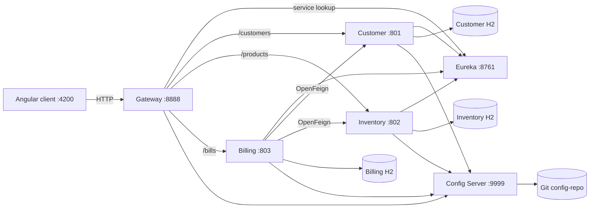

# Microservices billing application

Spring Boot microservices for managing customers, products, and invoices, with Eureka discovery, Spring Cloud Gateway, Spring Cloud Config, OpenFeign, and an Angular client.

## Services

| Service | Port | Purpose |
| --- | ---: | --- |
| config-service | 9999 | Central configuration from `config-repo` |
| discovery-service | 8761 | Eureka registry |
| gateway-service | 8888 | Static and discovery-based API routes |
| customer-service | 801 | Customer management |
| inventory-service | 802 | Product management |
| billing-service | 803 | Invoices and Feign lookups |
| Angular client | 4200 | Customer, product, and invoice screens |



## Run

Use Java 17 or newer and Maven. Start each Spring Boot service in a separate terminal, in this order: `discovery-service`, `config-service`, `customer-service`, `inventory-service`, `billing-service`, and `gateway-service`. Run commands below from the project root:

```sh
mvn -pl discovery-service spring-boot:run
mvn -pl config-service spring-boot:run
mvn -pl customer-service spring-boot:run
mvn -pl inventory-service spring-boot:run
mvn -pl billing-service spring-boot:run
mvn -pl gateway-service spring-boot:run
```

The config server reads the committed `config-repo/` directory from this project’s Git repository. Service-specific settings are in `<service-name>.yml`; common Eureka settings are in `application.yml`. The Eureka dashboard is at `http://localhost:8761`, and the customer configuration endpoint is `http://localhost:9999/customer-service/dev`.

Business services use the `dev` profile by default. For production settings, set `SPRING_PROFILES_ACTIVE=prod` when starting a service; profile-specific values are in `config-repo/*-dev.yml` and `config-repo/*-prod.yml`.

```sh
SPRING_PROFILES_ACTIVE=prod mvn -pl customer-service spring-boot:run
```

Build the Java services with `mvn -DskipTests package`. Start the Angular client from `angular-client` with `npm install` followed by `npm start`. It runs at `http://localhost:4200` and sends requests through `http://localhost:8888`.

## API

- `GET/POST /customers`, `GET/PUT/DELETE /customers/{id}`
- `GET/POST /products`, `GET/PUT/DELETE /products/{id}`
- `GET/POST /bills`, `GET /bills/{id}`

The gateway exposes these paths as well as discovery routes under `/<service-id>/**` (for example `/customer-service/customers`). H2 databases are local to their owning services. The billing service stores customer and product IDs, then obtains their details from the owning services through OpenFeign.

## Create an invoice

The customer and product services seed sample records when their in-memory databases are empty. An invoice request contains the customer ID and product IDs with quantities:

```sh
curl -X POST http://localhost:8888/bills \
  -H 'Content-Type: application/json' \
  -d '{"customerId":1,"items":[{"productId":1,"quantity":2}]}'
```

If a customer or inventory service is unavailable, the billing service keeps the invoice response and fills in the unavailable details with fallback values.

## Code structure

The customer, inventory, and billing services use the same clean-architecture boundaries:

- `domain/` holds the service’s domain records and repository ports.
- `application/` holds the use cases and outbound lookup ports.
- `adapter/in/web/` handles HTTP requests and responses.
- `adapter/out/` connects the use cases to JPA or other services through OpenFeign.

Eureka, Config Server, and Gateway are separate Spring Boot applications, each with its own Maven module and configuration.
